# Replacing the sawtooth: causal LTI operators for sparse event channels

Branch `exp/spike-conversion-general` (from `no-kEDM-gpu-optimization` @ 353fca0).
Data: `J1620210605_epoch_8_freq_40_Hz.csv` — 47,999 rows at 40 Hz (20 min),
468 single-unit channels (CA1, mPFC, OFC; 0.1–71 Hz), targets `head_position_x/y`.

## Summary

**Does a smooth causal operator make the network run better on its own than the
sawtooth? On this recording, no — with one narrow exception.** Nine full
pipeline runs (one network per setting, identical rows, 83 channels, 24
input-free 10-s free runs each) give:

1. **Only the sawtooth network stays alive.** Generated units keep 45 % of the
   recording's variability at 2 s (motion ratio 0.45); every decaying operator
   keeps 1–27 % and, by 10 s, 88–100 % of free runs have collapsed to a quiet
   fixed point (sawtooth 46 %; Gamma τ = 100 ms also 46 %, but it leaves the
   empirical manifold instead). The sawtooth is also the only setting whose
   (x, y) delay-embedding topology is at the noise floor (H0 Wasserstein-1
   1.6, floor 2.0; others 6–69).
2. **Log-compressed Gamma (m = 3, τ = 500 ms, κ = 100) tracks position best.**
   Its free-run path error is smaller than the sawtooth's, start by start, at
   2, 5 and 10 s (≈ 17 %, 11 %, 11 %; Wilcoxon p = 0.015, 0.039, 0.004,
   uncorrected; 0.004 survives Bonferroni over its own six tests, not over the
   whole 42-test table). It does so while its units are nearly still (motion
   ratio 0.015): the position nodes move, the population barely does.
3. **No setting beats holding still by much.** Median path error over
   "hold the seed position" is ≈ 1 for every setting at every horizon, with
   wide spread (medians ≈ 0.7–1.5); the median (x, y) correlation of a free run
   lies between −0.23 and 0.33. None of these
   networks is a generative model of the rat's behaviour; the comparison is
   between weak generators.
4. **One-step accuracy does not separate the methods.** At 25 ms every
   smooth signal is nearly persistent; skill over persistence is within ±0.2
   everywhere.
5. **Short timescales are the weakest representation.** τ = 100 ms Gamma
   decodes worst in Stage I, and its network leaves the empirical manifold
   (distance ratio 3–5) and has only 8 nodes.

**Why the decaying operators collapse — an interpretation, not tested here.** A Gamma, LMU or fading-signature
channel rises only when an event arrives, and the generator never produces
events — it produces the filtered value. A local linear map fitted to "rise
after an event, decay otherwise" averages to decay, so the free run decays
to the silence state (the prompt's "collapse to zero" premise, which does not
hold for the sawtooth input, does hold for the *generator* built on these
operators). The sawtooth ramps deterministically through every silence, so its
map always has a direction to move in.

**Also found:** a row-labelling bug in the parent's `Forecast()` for nodes
with lagged in-edges (Appendix A), fixed and regression-tested; four corrected
premises of the experiment prompt (Appendix A); a calibration rule that
predicts the operators' collapse fraction from the event rate (§6).

## 1. What was changed, and what was not

One selector, `TSLS_MDE_GMN_SPIKE_TRANSFORM ∈ {sawtooth, gamma, lmu, logsig}`,
chooses how each event channel becomes one continuous column. `sawtooth` is the
parent's time-since-last-spike (TSLS) converter, bit-for-bit
(`tests/test_spike_general_pipeline.py::test_transform_sawtooth_and_gamma_exact`).
Every method obeys the same contract:

* **one column per channel** — no PCA, no mixing; the vector-valued operators
  (LMU, log-signature) are reduced to one scalar per channel (§2.4), because a
  graph node in this pipeline is one column (audit, §A);
* **strictly causal** — the value at row *n* depends on events at rows ≤ *n* only;
* **no trainable parameters** — every operator is a fixed linear filter
  (plus, for the signature, a fixed polynomial map), set by one timescale.

Around the operators, the evaluation was changed so that a network can run on
its own and be judged on it (§3):

| Change | Setting | Why |
|---|---|---|
| Common trim | `WARMUP_ROWS=400`, + slowest first event | every method gets the same rows, so the train/validation/test split is identical |
| Observability filter | `N_MIN_EVENTS=100` | a channel needs events in the **training** rows to be modelled at all |
| Takens lag from data | `EMBED_TAU=auto`, `EMBED_TAU_METHOD=ami` | parent hard-coded τ = −1 row (25 ms) |
| Stage 2 lag step = Takens lag | `DELAY_SOURCE=tau_count` | lagged leaves at −τ, −2τ |
| Continuous metric for neurons | `METRIC=correlation` | the parent's `f1` decodes sawtooth resets; meaningless for smooth operators |
| Input-free free runs | `EXTERNAL_INPUT_MODE=self_simulate` | the parent default replays the recording into every zero-driver node |
| Autonomous evaluation | `ROLLOUT_N_STARTS=24` | rollouts, one-step, stability, topology, graph (§3) |

## 2. The operators

All are exact discretisations of a continuous linear system driven by the
event train *c[n]* (counts per 25 ms bin): `z[n] = Φ z[n−1] + B c[n]`,
`Φ = expm(A·dt)`. Exact (impulse-invariant) discretisation keeps the impulse
response of the continuous kernel at every sample, so nothing depends on the
bin width beyond sampling.

### 2.1 M1 — Gamma (Erlang) cascade
Kernel `g_m(t) = t^m e^{−t/τ} / (τ^{m+1} m!)`: a chain of *m*+1 leaky
integrators with a common time constant τ. Peak at *mτ*, mean (m+1)τ.
Options: order *m* ∈ {2, 3}, τ ∈ {100, 250, 500} ms, a multi-scale sum
(`GAMMA_TAUS_MS=100,500`), and log compression `log(1 + κ x / x̄)` with x̄ the
channel's training mean (κ = 100).

**Smoothness, corrected:** g_m and its first m−1 derivatives vanish at t = 0;
the m-th jumps. The response to one event is therefore C^{m−1}, not C^m. C²
needs m ≥ 3, which is why m = 3 is the default.

### 2.2 M2 — Legendre Memory Unit (LMU) state
`θ ż = A z + B u`, with Voelker's (A, B): the state is the projection of the
last θ seconds of input onto D shifted Legendre polynomials. θ ∈ {500, 1000, 2000} ms,
D ∈ {2, 3, 4}.

**Corrected premise:** the LMU impulse response `e^{As/θ}B/θ` is non-zero at
s = 0, so on a raw event train **the state jumps at every event** — it is as
discontinuous as the sawtooth. It becomes C^p only after a Gamma pre-filter of
order p (`LMU_PRESMOOTH_ORDER=p`, τ_p = θ/(4D) by default). Settings with
`_pre2` use p = 2.

### 2.3 M3 — Fading-memory log-signature
The path is X(t) = (t, N(t)), N = cumulative count. The fading signature
`S_n = δ_λ(S_{n−1}) ⊗ exp(ΔX_n)`, λ = e^{−dt/W}, is the signature of the
exponentially reweighted path, so its log is well defined (computed in the
truncated tensor algebra). Depth K ∈ {2, 3}; Lyndon coordinates:

| K | coordinates | meaning |
|---|---|---|
| 1 | N | faded count (an exponential filter) |
| 2 | [t, N] | Lévy area: > 0 when the faded events are recent, < 0 when old |
| 3 | [t,[t,N]], [[t,N],N] | curvature in time; burstiness |

Like the LMU, the raw state jumps at events; `LOGSIG_PRESMOOTH_ORDER=3`
pre-filters the event train with a Gamma cascade (τ_p = W/8).

### 2.4 One scalar per channel
`lmu_norm` (LMU default): `sqrt(Σ_d m_d² / (2d+1))`, proportional to the L²
norm, over the window, of the input the D Legendre coefficients reconstruct.
`rms_norm` (log-signature default): each coordinate divided by its training
RMS, then the Euclidean norm (uncentred, so a quiet window maps to ≈ 0). Stage I
shows the reduction loses ≈ 0.1 of cross-map r without delays and nothing once
the scalar is delay-embedded (§4).

## 3. Evaluation

* **Takens lag** — first minimum of the average mutual information (16 bins;
  a minimum counts only once AMI has risen ≥ 2 % of its range after it, so
  noise wiggles do not count); fallback ACF 1/e; capped at 40 rows (1 s).
  Median over channels, training rows only.
* **One-step** — gmn `Forecast()` over the whole held-out segment (6,667 rows,
  167 s); r and NRMSE per node; skill = 1 − NRMSE / NRMSE(persistence).
* **Free runs** — gmn `Generate()` from 24 evenly spaced held-out starts,
  400 steps (10 s), scored at 2, 5, 10 s: r and speed-weighted r of (x, y)
  against the recording, NRMSE, mean (x, y) path error against **holding the
  seed position**.
* **Attractor stability** — `manifold_ratio`: nearest-neighbour distance of the
  generated population state to the training cloud, over the same for the
  recording at those rows (1 = as on-manifold as the data); `motion_ratio`: sd
  over the last min(h, 2 s), generated / recorded, median over nodes that move
  in the recording (≪ 1 = collapse to a fixed point); `collapsed` = motion_ratio
  < 0.05; `blew_up` = non-finite or > 10× the library's largest |z|.
* **Topology** — Vietoris–Rips persistence (H0 from the MST; H1 by Z/2
  boundary-matrix reduction to the enclosing radius; 80 max-min landmarks) of
  the (x, y) delay embedding and of the population state, all clouds scaled by
  the training data. Wasserstein-1 generated-vs-real. **Noise floor:** the same
  number of equal-length windows drawn from the training rows, vs real — a
  generator is as faithful as the data allows when its distance is at the floor.
* **Graph** — nodes, lagged leaves, edges, density, zero-driver nodes,
  within-region edge fraction, target drivers.

## 4. Stage I — representation screen (46 settings, no network)

`scripts/experiments/spike_general/screen_representations.py`, on a compute
node. Per setting, over the channels the pipeline uses (30 per region, 83 after the observability filter) and
the MDE validation segment: smoothness, collapse, degeneracy, the Takens lag,
per-channel cross-map to (x, y), a greedy 6-channel joint readout (S-map), and
1-s self-prediction against persistence. Full table: [`stage1_table.md`](stage1_table.md);
raw: `stage1_screen.csv`.

| setting | roughness ↓ | collapse fraction ↓ | joint (x, y) readout r ↑ | 1-s self-prediction gain over persistence ↑ |
|---|---|---|---|---|
| **gamma_m3_t500_log100** | 0.117 | 0.068 | **0.884** | 0.019 |
| logsig_W2000_K2_pre3 | 0.067 | **0.012** | 0.874 | −0.061 |
| sawtooth | 1.417 | 0.023 | 0.869 | −0.071 |
| gamma_m2_t500 | 0.065 | 0.248 | 0.868 | −0.015 |
| lmu_th2000_D2_pre2 | 0.056 | 0.160 | 0.862 | 0.005 |
| gamma_m3_t500 | **0.043** | 0.197 | 0.849 | **0.030** |
| gamma_m3_t250 | 0.084 | 0.417 | 0.787 | −0.049 |
| lmu_th1000_D3 | 1.429 | 0.512 | 0.783 | −0.121 |
| logsig_W1000_K3 | 1.441 | 0.208 | 0.817 | −0.139 |
| gamma_m3_t100 | 0.211 | 0.665 | 0.730 | −0.069 |
| lmu_th500_D3 | 1.480 | 0.670 | 0.669 | −0.068 |

roughness = sd(2nd difference)/sd(1st difference) (≈ 1.4 for a jump train, ≪ 1
for a smooth signal); collapse fraction = share of time the median channel sits
on its floor.

* **Smoothness does not buy decodability** (figure below). Presmoothing the LMU
  and log-signature cuts roughness from ≈ 1.4 to 0.06–0.23 (θ, W ≥ 1 s) but moves
  the readout by −0.08 to +0.05, in no consistent direction.
* **Timescale is what matters.** At the shortest timescales (Gamma τ = 100 ms,
  LMU θ = 500 ms) channels spend 55–70 % of the time on the floor and decode
  worst (0.66–0.76); memories of 1–2 s decode best.
* **Log compression** removes most of the collapse (τ = 500 ms: 0.197 → 0.068)
  and gives the best readout.
* **No population-level degeneracy**: in no setting is any library population
  state's nearest non-adjacent neighbour closer than 1 % of the median
  nearest-neighbour distance — silent channels collapse, but the 83-channel state
  never does.
* **The one-scalar-per-channel reduction costs nothing once delays are used.**
  Without delays, the scalar loses 0.06–0.18 (median 0.11) of per-channel
  cross-map r against the full LMU / signature vector; the scalar's own
  3-lag delay embedding recovers it (scalar-with-delays minus vector: median
  −0.005, range −0.07 to +0.05; 30 settings). Takens delays reconstruct what the
  reduction drops.
* **Takens lag** hits the 1-s cap (40 rows) for almost every setting.

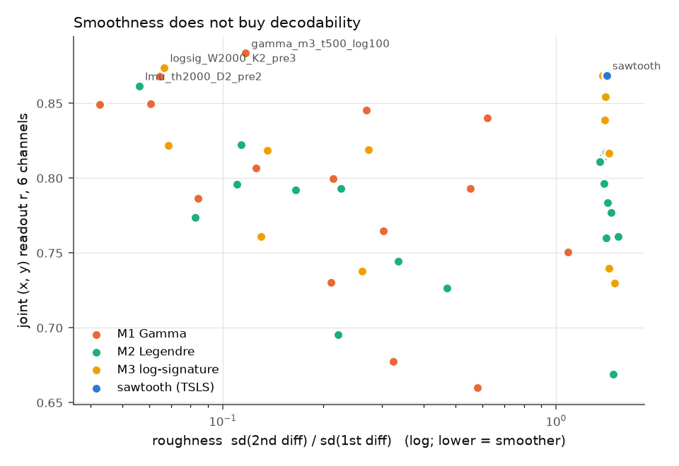
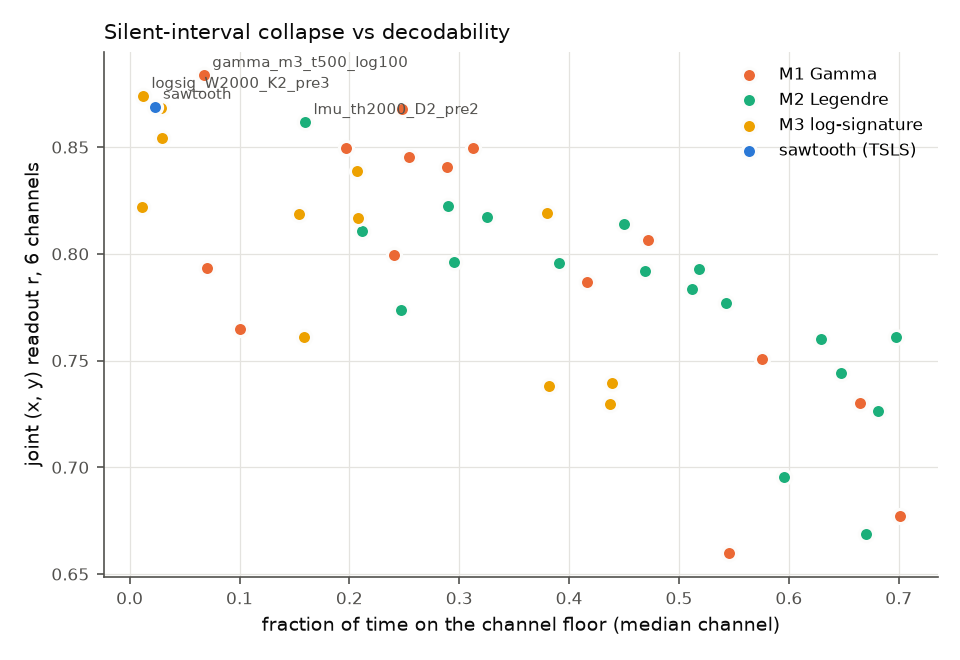
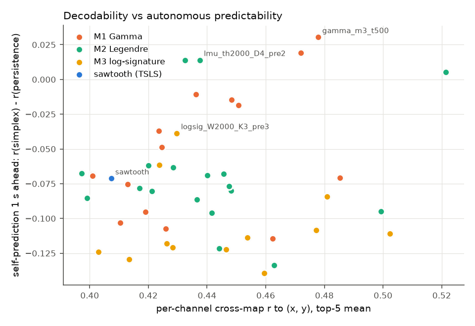
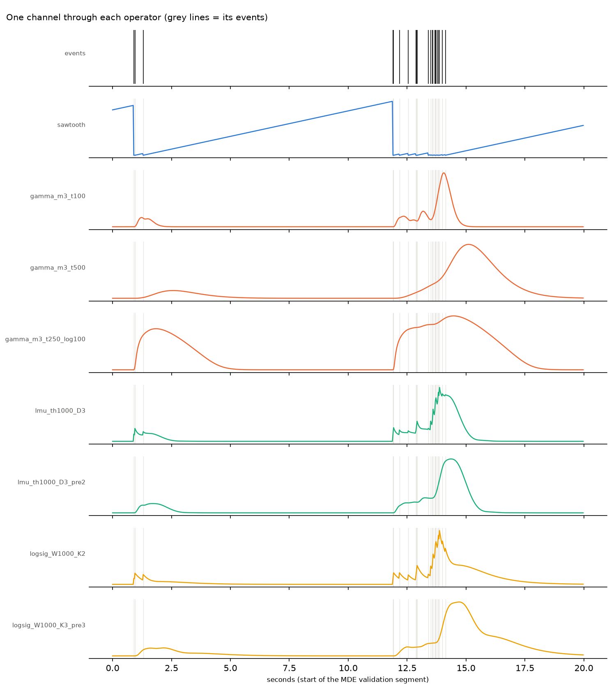

The traces show the core trade-off: through a 10-s silence every decaying
operator goes flat while the sawtooth keeps ramping.

## 5. Stage II — full pipeline, input-free free runs (9 settings)

One Saion job per setting (`scripts/batch/saion-spike-general.sbatch`, 1 GPU,
9 CPUs; 53 min – 2 h 46 min each), job ids and staged commits in
[`jobs.tsv`](jobs.tsv). Identical for every setting: 30 channels per region,
observability filter (83 kept), common trim, MDE D = 6, nested M = 2,
`METRIC=correlation`, CCM window 4,000 rows, Takens lag from AMI, Stage 2 lags
−τ and −2τ, `EXTERNAL_INPUT_MODE=self_simulate`, per-node θ retuned on the
library. Held-out segment: rows 37,781–44,447 (167 s); 24 starts, 10 s each.
All nine completed with no failed MDE call. Aggregation:
`scripts/experiments/spike_general/aggregate.py` → `stage2_summary.csv`,
`stage2_rollouts_all.csv`, `stage2_paired_vs_sawtooth.csv`,
[`stage2_tables.md`](stage2_tables.md).

The settings: the baseline; Gamma (m = 3) at the three prompt timescales and
the best Stage I variant (500 ms + log); for the LMU and the log-signature, the
best Stage I setting (presmoothed) and the setting the prompt specifies as is
(raw, which jumps at events).

### Free-run accuracy (median over starts)

| setting | r 2 s | r 5 s | r 10 s | speed-wtd r 10 s | NRMSE 10 s | path err 2 s | hold 2 s | path err 10 s | hold 10 s |
|---|---|---|---|---|---|---|---|---|---|
| sawtooth | 0.267 | 0.119 | 0.132 | 0.134 | 0.817 | 5.54 | 7.89 | 27.12 | 33.51 |
| gamma_m3_t100 | 0.045 | 0.082 | 0.015 | 0.052 | 1.092 | 7.08 | 7.98 | 32.30 | 33.84 |
| gamma_m3_t250 | 0.118 | 0.013 | -0.013 | -0.020 | 1.132 | 7.01 | 7.89 | 36.17 | 33.51 |
| gamma_m3_t500 | 0.208 | 0.330 | 0.166 | 0.184 | 1.219 | 7.62 | 7.89 | 37.56 | 33.51 |
| gamma_m3_t500_log100 | 0.210 | 0.129 | 0.017 | -0.090 | 0.918 | 2.39 | 7.89 | 26.88 | 33.51 |
| lmu_th1000_D3 | 0.176 | -0.002 | -0.002 | 0.021 | 1.094 | 5.34 | 7.02 | 31.80 | 33.25 |
| lmu_th2000_D2_pre2 | 0.097 | 0.142 | 0.208 | 0.229 | 1.150 | 7.23 | 7.89 | 37.74 | 33.51 |
| logsig_W1000_K3 | 0.082 | -0.231 | -0.102 | -0.133 | 0.981 | 4.50 | 7.89 | 29.05 | 33.51 |
| logsig_W2000_K2_pre3 | -0.001 | 0.246 | 0.001 | 0.007 | 1.069 | 6.00 | 7.89 | 30.33 | 33.51 |

### Attractor stability (median over starts; fractions over starts)

| setting | manifold 2 s | manifold 10 s | motion 2 s | motion 10 s | collapsed 10 s | blew up 10 s | unit r 2 s |
|---|---|---|---|---|---|---|---|
| sawtooth | 0.919 | 0.851 | 0.453 | 0.054 | 0.458 | 0.000 | 0.203 |
| gamma_m3_t100 | 3.197 | 4.887 | 0.095 | 0.069 | 0.458 | 0.000 | 0.081 |
| gamma_m3_t250 | 1.001 | 1.437 | 0.027 | 0.029 | 0.917 | 0.000 | -0.049 |
| gamma_m3_t500 | 0.999 | 1.278 | 0.013 | 0.010 | 1.000 | 0.000 | 0.056 |
| gamma_m3_t500_log100 | 1.015 | 1.257 | 0.018 | 0.015 | 1.000 | 0.000 | 0.157 |
| lmu_th1000_D3 | 0.757 | 0.724 | 0.196 | 0.001 | 1.000 | 0.000 | 0.057 |
| lmu_th2000_D2_pre2 | 1.013 | 1.132 | 0.023 | 0.019 | 0.875 | 0.167 | -0.157 |
| logsig_W1000_K3 | 0.850 | 0.787 | 0.268 | 0.000 | 1.000 | 0.000 | -0.046 |
| logsig_W2000_K2_pre3 | 0.975 | 0.996 | 0.023 | 0.019 | 0.958 | 0.000 | -0.112 |

### One-step accuracy over the whole held-out segment (median over nodes)

| setting | r (x, y) | skill vs persistence (x, y) | driven units | r (driven units) | skill vs persistence (driven units) | rescored |
|---|---|---|---|---|---|---|
| sawtooth | 1.000 | 0.090 | 9 | 0.991 | 0.002 | True |
| gamma_m3_t100 | 1.000 | -0.191 | 3 | 0.998 | 0.003 | True |
| gamma_m3_t250 | 1.000 | 0.010 | 5 | 1.000 | 0.108 | True |
| gamma_m3_t500 | 1.000 | 0.048 | 4 | 1.000 | 0.002 | True |
| gamma_m3_t500_log100 | 1.000 | 0.041 | 7 | 1.000 | 0.069 | False |
| lmu_th1000_D3 | 1.000 | 0.051 | 6 | 0.994 | 0.010 | False |
| lmu_th2000_D2_pre2 | 1.000 | -0.013 | 5 | 1.000 | 0.166 | False |
| logsig_W1000_K3 | 1.000 | 0.085 | 4 | 0.978 | 0.007 | False |
| logsig_W2000_K2_pre3 | 1.000 | 0.067 | 6 | 1.000 | 0.067 | False |

### Topology of the (x, y) delay embedding: Wasserstein-1 distances

| setting | H0 gen-real | H1 gen-real | H0 lib-real (floor) | H1 lib-real (floor) | H1 bars real | H1 bars gen | pop H1 gen-real | pop H1 lib-real (floor) |
|---|---|---|---|---|---|---|---|---|
| sawtooth | 1.623 | 2.181 | 2.023 | 2.090 | 10 | 9 | 12.701 | 13.929 |
| gamma_m3_t100 | 23.991 | 2.569 | 2.023 | 2.090 | 10 | 2 | 9.467 | 11.391 |
| gamma_m3_t250 | 37.269 | 2.801 | 2.023 | 2.090 | 10 | 11 | 12.941 | 12.298 |
| gamma_m3_t500 | 13.115 | 2.569 | 2.023 | 2.090 | 10 | 6 | 10.200 | 8.068 |
| gamma_m3_t500_log100 | 13.307 | 2.529 | 2.023 | 2.090 | 10 | 5 | 14.220 | 12.128 |
| lmu_th1000_D3 | 6.173 | 2.416 | 2.023 | 2.090 | 10 | 3 | 11.162 | 7.905 |
| lmu_th2000_D2_pre2 | 69.004 | 2.882 | 2.023 | 2.090 | 10 | 6 | 12.565 | 8.628 |
| logsig_W1000_K3 | 19.618 | 2.800 | 2.023 | 2.090 | 10 | 5 | 8.891 | 9.376 |
| logsig_W2000_K2_pre3 | 22.130 | 3.186 | 2.023 | 2.090 | 10 | 2 | 9.042 | 11.395 |

### Graph (one combined network per run)

| setting | Takens lag (rows) | channels kept | real nodes | lagged leaves | edges | density | edges/node | zero-driver | within-region | target drivers |
|---|---|---|---|---|---|---|---|---|---|---|
| sawtooth | 40 | 83 | 27 | 40 | 78 | 0.048 | 1.164 | 56 | 0.256 | x: CA1_29_tsls::delay-40, CA1_2_tsls, CA1_4_tsls::delay-80, CA1_6_tsls, OFC_12_tsls::delay-80; y: CA1_11_tsls::delay-80, CA1_23_tsls::delay-40, CA1_2_tsls, CA1_6_tsls, OFC_19_tsls::delay-40, mPFC_21_tsls::delay-40, mPFC_24_tsls::delay-80 |
| gamma_m3_t100 | 23 | 83 | 8 | 13 | 21 | 0.125 | 1.000 | 16 | 0.333 | x: CA1_6_gam, CA1_6_gam::delay-23, CA1_6_gam::delay-46; y: CA1_6_gam, OFC_19_gam::delay-23 |
| gamma_m3_t250 | 40 | 83 | 23 | 22 | 53 | 0.047 | 1.178 | 38 | 0.340 | x: CA1_29_gam::delay-40, CA1_6_gam; y: CA1_23_gam::delay-40, CA1_23_gam::delay-80, CA1_6_gam, CA1_6_gam::delay-80, OFC_22_gam::delay-40, OFC_22_gam::delay-80 |
| gamma_m3_t500 | 40 | 83 | 17 | 29 | 48 | 0.062 | 1.043 | 40 | 0.354 | x: CA1_29_gam::delay-40, CA1_29_gam::delay-80, CA1_6_gam; y: CA1_23_gam::delay-40, CA1_24_gam::delay-40, CA1_26_gam::delay-80, CA1_6_gam, OFC_19_gam::delay-40, OFC_19_gam::delay-80, OFC_22_gam::delay-40 |
| gamma_m3_t500_log100 | 40 | 83 | 29 | 33 | 71 | 0.038 | 1.145 | 53 | 0.408 | x: CA1_29_gam::delay-40, CA1_29_gam::delay-80, CA1_6_gam; y: CA1_24_gam::delay-40, CA1_25_gam::delay-80, CA1_27_gam::delay-80, CA1_6_gam, OFC_19_gam::delay-40, mPFC_15_gam::delay-80, mPFC_9_gam::delay-40 |
| lmu_th1000_D3 | 36 | 83 | 22 | 25 | 54 | 0.052 | 1.149 | 39 | 0.259 | x: CA1_29_lmu::delay-36, CA1_29_lmu::delay-72, CA1_6_lmu, CA1_6_lmu::delay-36, CA1_6_lmu::delay-72, OFC_17_lmu::delay-36; y: CA1_6_lmu, OFC_19_lmu::delay-72 |
| lmu_th2000_D2_pre2 | 40 | 83 | 19 | 23 | 46 | 0.058 | 1.095 | 35 | 0.217 | x: CA1_29_lmu::delay-40, CA1_6_lmu; y: CA1_23_lmu::delay-40, CA1_25_lmu::delay-40, CA1_6_lmu, CA1_6_lmu::delay-80, OFC_19_lmu::delay-40, OFC_22_lmu::delay-40, OFC_22_lmu::delay-80 |
| logsig_W1000_K3 | 40 | 83 | 20 | 24 | 54 | 0.061 | 1.227 | 38 | 0.259 | x: CA1_6_lsig, CA1_6_lsig::delay-40, CA1_6_lsig::delay-80, OFC_17_lsig::delay-40; y: CA1_25_lsig::delay-40, CA1_26_lsig::delay-40, CA1_26_lsig::delay-80, CA1_6_lsig, OFC_19_lsig::delay-40, OFC_19_lsig::delay-80 |
| logsig_W2000_K2_pre3 | 40 | 83 | 22 | 29 | 57 | 0.045 | 1.118 | 43 | 0.281 | x: CA1_6_lsig, CA1_6_lsig::delay-40, CA1_6_lsig::delay-80; y: CA1_14_lsig::delay-40, CA1_23_lsig::delay-40, CA1_24_lsig::delay-40, CA1_6_lsig, CA1_6_lsig::delay-80, CA1_9_lsig::delay-40, mPFC_20_lsig::delay-40 |

### Paired against the sawtooth, start by start (median difference; Wilcoxon p)

Δr > 0: better (x, y) correlation than the sawtooth. Δlog path < 0: smaller path error than the sawtooth.

| setting | pairs | Δr 2 s | p 2 s | Δlog path 2 s | p 2 s | Δr 5 s | p 5 s | Δlog path 5 s | p 5 s | Δr 10 s | p 10 s | Δlog path 10 s | p 10 s |
|---|---|---|---|---|---|---|---|---|---|---|---|---|---|
| gamma_m3_t100 | 24 | -0.041 | 0.565 | 0.060 | 0.684 | -0.141 | 0.422 | -0.020 | 0.922 | -0.024 | 0.422 | -0.005 | 0.643 |
| gamma_m3_t250 | 24 | 0.037 | 0.989 | 0.123 | 0.345 | -0.097 | 0.303 | 0.126 | 0.143 | -0.100 | 0.025 | 0.056 | 0.084 |
| gamma_m3_t500 | 24 | 0.024 | 0.922 | 0.134 | 0.345 | 0.052 | 0.390 | 0.032 | 0.643 | -0.076 | 0.303 | -0.027 | 0.944 |
| gamma_m3_t500_log100 | 24 | -0.004 | 0.663 | -0.187 | 0.015 | -0.013 | 1.000 | -0.118 | 0.039 | -0.080 | 0.197 | -0.119 | 0.004 |
| lmu_th1000_D3 | 24 | -0.008 | 0.944 | -0.012 | 0.790 | -0.155 | 0.095 | -0.155 | 0.390 | -0.127 | 0.074 | -0.037 | 0.643 |
| lmu_th2000_D2_pre2 | 24 | 0.030 | 0.989 | 0.053 | 0.509 | 0.069 | 0.966 | -0.072 | 0.546 | -0.107 | 0.439 | 0.034 | 0.218 |
| logsig_W1000_K3 | 24 | -0.048 | 0.527 | 0.098 | 0.726 | -0.194 | 0.027 | -0.027 | 0.623 | -0.175 | 0.107 | 0.022 | 0.290 |
| logsig_W2000_K2_pre3 | 24 | -0.035 | 0.527 | 0.114 | 0.643 | 0.001 | 0.922 | -0.006 | 0.989 | -0.019 | 0.264 | -0.078 | 0.375 |

"rescored": one-step re-run with the fixed `Forecast()` for the four jobs
staged before the fix (Appendix A); the other five ran the fixed code.

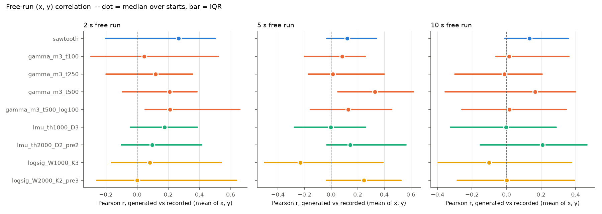
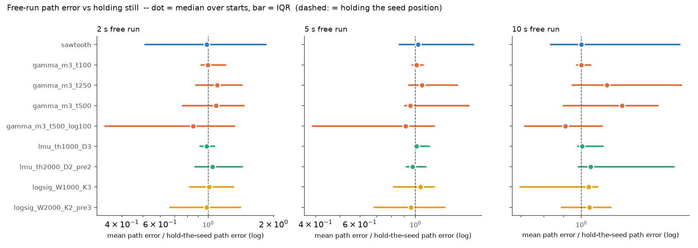
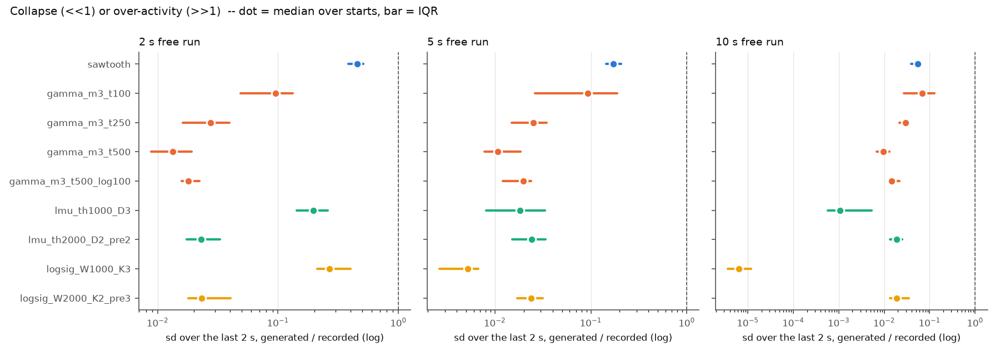
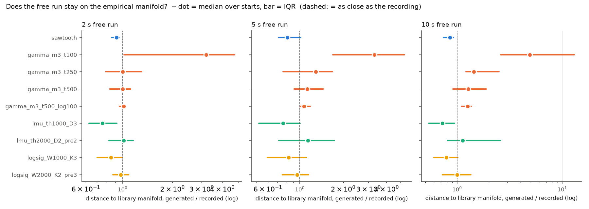

Example free runs (four starts; black recorded, red generated) and the (x, y)
persistence diagrams, for the baseline and the setting that tracks best:

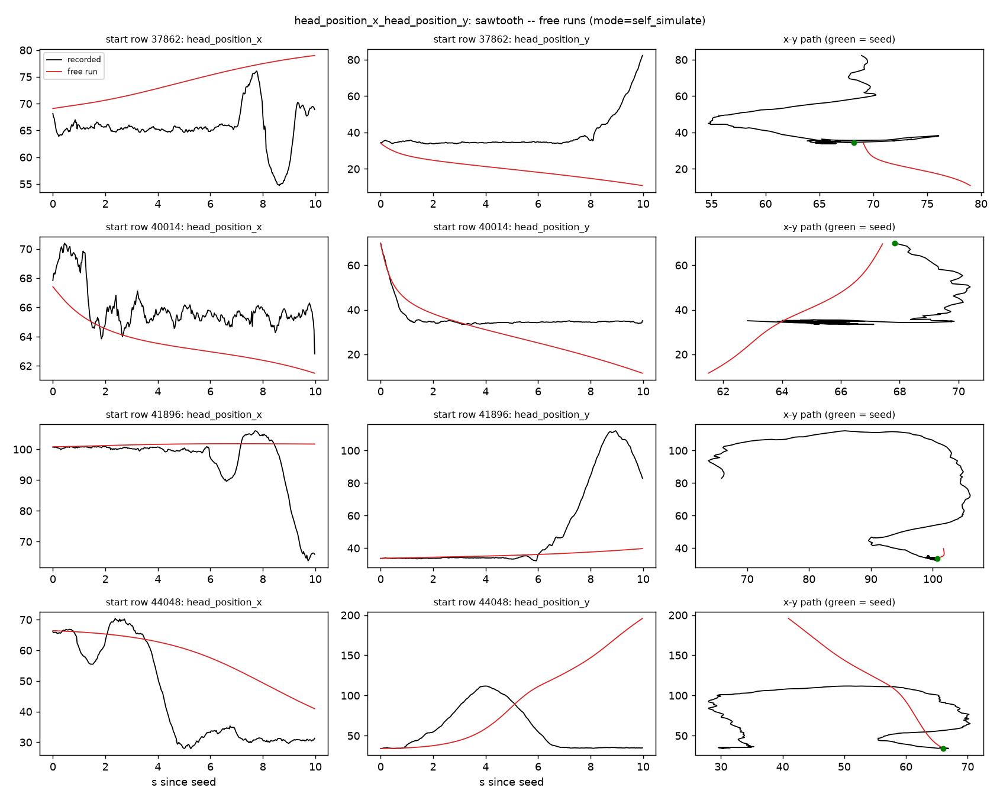
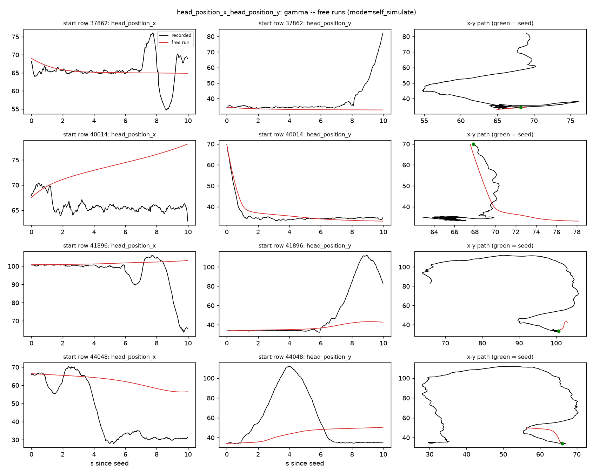
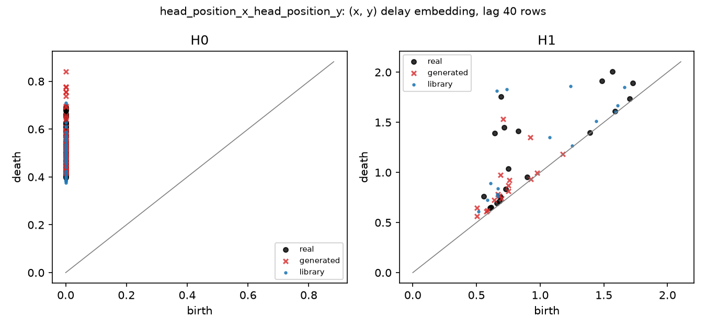
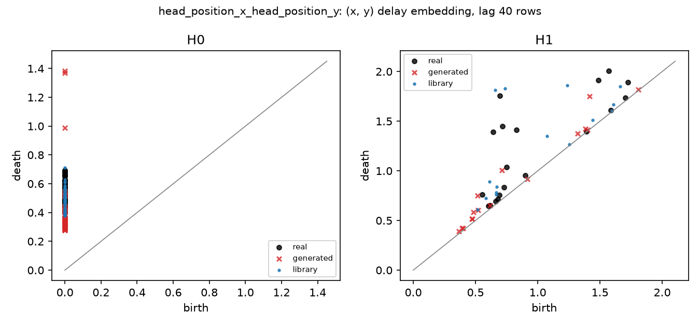

Every setting's rollout, (x, y) and population persistence figures are in
[`figures/stage2/`](figures/stage2/).

### Reading the tables

* **Activity.** Motion ratio separates the methods most clearly: sawtooth 0.45
  at 2 s; raw LMU and raw log-signature 0.20–0.27 at 2 s (their jumps keep
  them moving briefly), then ≤ 0.001 by 10 s; every smooth operator ≤ 0.10 from
  the start.
* **Topology.** H0 (connected structure of the (x, y) delay cloud) separates
  the methods: the sawtooth sits at the noise floor (1.6 vs 2.0); the others
  are 3–35× the floor — their generated (x, y) clouds are fragmented or
  contracted. H1 (loops) does not separate them: every setting is 1.0–1.5× the
  floor, and the real data's ten H1 bars are short (max persistence ≈ 1 in
  library-sd units).
* **Staying on the manifold.** The sawtooth, raw LMU and raw log-signature stay
  closer to the library than the recording does (ratio 0.72–0.92, which is
  what a run that slows down near visited states looks like); Gamma τ = 100 ms
  leaves it (3–5); the rest sit at 1.0–1.44.
* **Stability.** No setting diverged except the presmoothed LMU (17 % of starts
  blew up by 10 s).
* **Graphs.** All are sparse (density 0.04–0.06, ≈ 1.1 edges per node) except
  Gamma τ = 100 ms, whose shorter Takens lag (23 rows) and heavy collapse leave
  an 8-node network. Every setting picks CA1_6 as a direct driver of both
  coordinates, and CA1_29 / CA1_23 / OFC_19 recur across methods — the
  selected drivers are a property of the data more than of the operator.
  Within-region edges are 22–41 % of all edges.

## 6. Calibrating τ, θ, W for a new event dataset

Every timescale reduces to one quantity, the operator's **memory**
`T_mem` — Gamma: (m+1)τ (the kernel's mean delay); LMU: θ; log-signature: W —
compared with the channels' **mean inter-event interval** (`ISI`).
`universal_point_process_embeddings.auto_timescale` computes the median
channel's mean ISI on the training rows only; a config value `auto:<k>` sets
the timescale to k × that. Here: rates 0.13–16.8 Hz over the 83 kept channels
(median 0.73 Hz), median mean ISI **1.37 s**.

**The collapse rule.** For a Poisson-like channel the share of time a decaying
operator sits on its floor is ≈ `exp(−T_mem / ISI)`. Checked against Stage I:

| setting | T_mem | predicted | measured |
|---|---|---|---|
| gamma m3 τ100 | 0.4 s | 0.75 | 0.67 |
| gamma m3 τ250 | 1.0 s | 0.48 | 0.42 |
| gamma m3 τ500 | 2.0 s | 0.23 | 0.20 |
| gamma m2 τ500 | 1.5 s | 0.33 | 0.25 |
| LMU θ500 | 0.5 s | 0.69 | 0.67 |
| LMU θ1000 | 1.0 s | 0.48 | 0.51 |
| LMU θ2000 | 2.0 s | 0.23 | 0.29 |
| log-sig W1000 | 1.0 s | 0.48 | 0.21 |
| log-sig W2000 | 2.0 s | 0.23 | 0.03 |

It holds for Gamma and the LMU within ≈ 0.1; it over-predicts for the
log-signature, whose Lévy-area and time coordinates do not decay to zero.

**Guidelines**

1. **Set the memory from the event rate, not from a fixed number of ms.**
   Choose a target floor fraction c* (≈ 0.2 worked here) and set
   `T_mem = ISI · ln(1/c*)` ≈ 1.6 × ISI. Concretely:
   Gamma `GAMMA_TAUS_MS=auto:k` with k = 1.6/(m+1) (m = 3: k ≈ 0.4);
   LMU θ = 1.6 × ISI; log-signature W ≈ ISI (it collapses less).
   On this dataset that is τ ≈ 550 ms, θ ≈ 2.2 s, W ≈ 1.4 s — the region where
   Stage I decoded best. Timescales ≤ 0.3 × ISI decoded worst.
2. **Use m = 3 for the Gamma** (the lowest order whose event response is C²),
   **log compression** (κ ≈ 100) to cut the remaining floor time by ≈ 3×, and
   **presmoothing** (order 2–3) for the LMU and log-signature, whose raw states
   jump at every event. For the LMU, D = 2 decoded best at θ = 2 s presmoothed (0.862 vs 0.774 / 0.823 for
   D = 3 / 4); across the other θ there is no consistent trend in D.
3. **Channel filter** `N_MIN_EVENTS`: require ≈ 10 events per MDE window in the
   training rows, i.e. N_min ≈ 10 × (training rows / window rows) = 10 × 33,599 /
   4,000 ≈ 84 → 100 here. It removed 7 of 90 channels.
4. **Takens lag**: AMI first minimum on the training rows, median over
   channels, capped. With smooth operators at T_mem ≈ 1–2 s the minimum is
   usually past 1 s, so the cap (40 rows here) decides it; set the cap from
   the forecast horizon you need (the Stage 2 lags are −τ, −2τ), not from the
   AMI alone.
5. **Check before running the network**: the Stage I screen
   (`screen_representations.py`, 5–8 min per setting; settings run in parallel) predicts the
   ordering of the decoding results; it does **not** predict free-run activity —
   check the operator's collapse fraction, and expect a generator built on a
   decaying operator to fall silent unless something drives it (§7).

## 7. Limitations and what to try next

* **One network per setting.** Each row of the Stage II tables is one built
  network; the spread is over 24 start points of that network, not over
  independent builds. Differences between settings include MDE's selection
  noise, which this design cannot separate from the operator's effect.
* **Reduced scale.** 30 channels per region (90 of 468), MDE D = 6, M = 2.
* **Lagged leaves are self-simulated.** Under `self_simulate` a lagged leaf
  `X::delay-k` is generated as its own one-dimensional self-map, not as the
  delayed copy of the generated X (a parent-design limitation, applied to every
  method). Every network here uses lagged leaves for the targets.
* **The Takens lag was not ablated.** It hit the 40-row cap for most channels in
  every setting, so all methods ran with lags of 40/80 rows instead of the
  parent's 1 row. A sawtooth run at the parent's τ = 1 would separate the
  effect of the lag change from that of the operator; it was not run.
* **Single recording, single session.** No claim here is tested on a second
  dataset.
* **Multiple comparisons.** The paired table holds 42 uncorrected tests.
* **Compute.** Saion's `intel` partition was unavailable (saturated; nodes
  intermittently not ready), so every job ran on the GPU partitions, shared with
  the sibling experiment's jobs. Deigo was unreachable (host-key verification
  failure, not overridden).

**What to try.** The collapse result points at the generator, not the
operator: a decaying representation needs a source of events during the free
run. Two options that keep the operators domain-agnostic: (i) generate the
event channel itself (a point-process node whose intensity is a smooth
function of the network state, then filter its draws through the same
operator); (ii) feed the operator's own rise back — make each node's map
predict the *innovation* (the part of the next value not explained by
the operator's deterministic decay, `x[n] − Φ x[n−1]`), so a free run must
choose when to inject events instead of averaging them away.

## A. Audit of the parent pipeline (Step 1)

* **Event preprocessing:** `tsls_data.py::convert_to_tsls()` →
  `cleaned_helper_functions.compute_time_since_previous_spike()`;
  `burn_in_trim()` drops rows until every channel has fired once.
* **Network construction:** `mde.py` (forward selection with a CCM gate),
  `network.py` / `network_parallel.py` (two-stage nested graph; Stage 2 adds
  lagged copies as leaf nodes).
* **Free run:** `generate.py` (gmn `Generate()` / `Forecast()`), `theta.py`
  (per-node S-map θ), `gmn_embedding.py` (each node embeds on its own in-edges
  plus its own present value).
* **Nodes are scalar.** A node is a DataFrame column; there is no multi-column
  node. Hence §2.4.
* **The parent's "free run" is not input-free.** With
  `EXTERNAL_INPUT_MODE=real_data` every zero-driver node, including every
  lagged leaf, replays the recording. `self_simulate` is input-free, but it
  simulates a lagged leaf `X::delay-k` as its own one-dimensional self-map, not
  as the delayed copy of the generated X — a limitation kept here, applied
  equally to every method.
* **Sawtooth-specific evaluation:** neuron nodes were scored by `f1` on reset
  events decoded from the sawtooth, and each neuron's MDE window was grown until
  it held `MIN_PRED_EVENTS` resets. Both now apply only under an event metric
  (`f1`, `gamma`).
* **Fixed Takens lag** τ = −1 row everywhere.

### Corrections to the experiment prompt's premises

1. *"The sawtooth needs t_{k+1}"* — not in this code: TSLS(t) = t − (last
   event ≤ t) is causal. Its defect is the jump at each event, not look-ahead.
2. *"Gamma order m is C^m"* — the response to an event is C^{m−1}.
3. *"The LMU gives smooth coordinates"* — on raw events the LMU state jumps at
   every event; it needs a pre-filter.
4. *"Silent intervals collapse to (0, …, 0)"* — true of every decaying operator
   (Gamma, LMU, fading signature) and **not** of the sawtooth, which ramps
   through a silence. Measured: §4.

### A bug found in the parent's Forecast() (fixed on this branch)
`_generalized_node_forecast` applied the configured lib/pred row range
unchanged to each node's embedding frame, which starts `offset` rows into the
data (offset = the node's deepest edge delay); gmn then labels every node's
predictions with the Time column of an offset-0 source node. A node with a
lagged in-edge therefore predicted rows *k* later than its label. In the
parent's runs (lags of a few rows) this mildly shifted the Forecast()
diagnostic; at this branch's lags (40/80 rows) it sent every driven node's
one-step r to ≈ 0. The predictions themselves were causal — only the labels
were wrong — and `Generate()`, θ tuning, and the network were never affected.
Fixed in 773e99d (`tests/test_forecast_offset_alignment.py`: with the fix
r = 0.9999 at the label, before it r = −0.72 at the label and 0.9999 six rows
away). Jobs that ran the old code had their one-step re-run with
`scripts/experiments/spike_general/rescore_onestep.py`.
