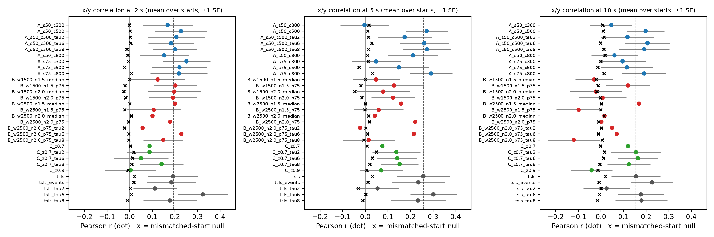
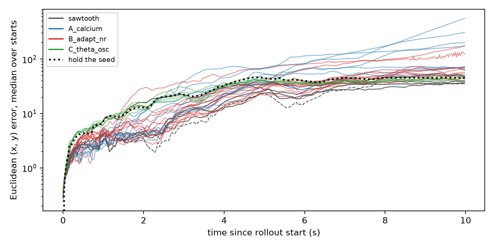
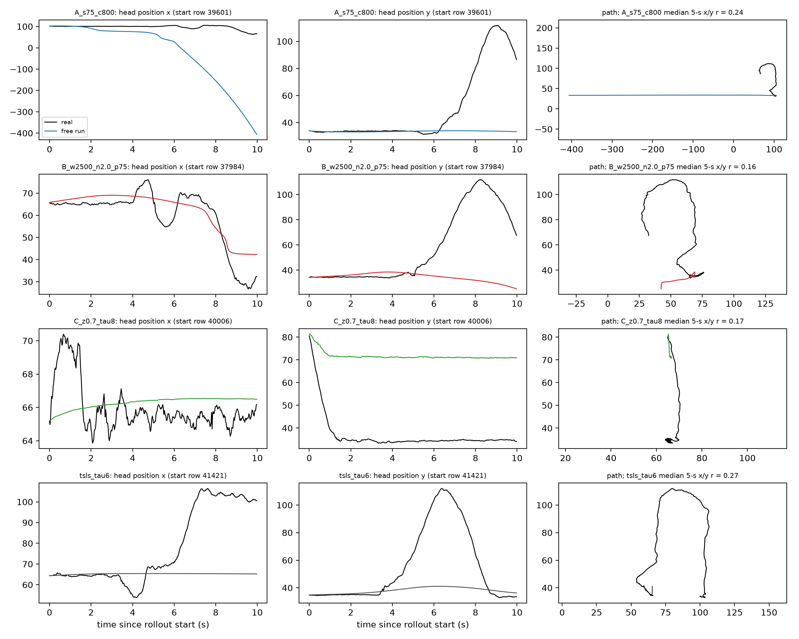
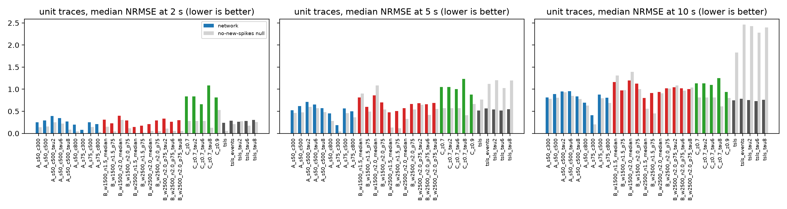

# Spike-train conversion: sawtooth vs biophysical state models

Branch `exp/spike-conversion-neuro` (worktree `/home/j/j-tominaga/pao_rotation-exp-neuro`),
forked from `no-kEDM-gpu-optimization` at `0022465`. Brief:
`clean_scripts/docs/experiments/spike-conversion_neuro/prompt_neuro.md`.

## Summary and recommendation

**Keep the sawtooth.** Consider τ = 6 instead of 4. If a smooth trace is
required, use Model A (τ_syn = 50 ms, τ_Ca = 500 ms) with τ = 8. Do not use
Model C, or Model B with τ_w = 1500 ms. What limits the networks is not the
spike representation.

The evidence (30 jobs, 32 free runs each, reduced 89-unit network; §4):

1. **No smooth representation beats the sawtooth on behaviour.**
   * Each family's best 5-s free-run x/y correlation is within one SE of the
     sawtooth's: A 0.27–0.29, B 0.22, sawtooth 0.26 (0.30 at τ = 6), SE ≈ 0.1.
   * The sawtooth never blows up, stays at or below the hold-the-seed path
     error at 10 s, and has the lowest 5-s path error (`tsls_events`, 7.2
     against hold 23.2).
   * Model B with τ_w = 1500 ms blows up in 38–84% of 10-s runs. Model A with
     τ_Ca ≥ 500 ms drifts out of the arena at τ = 4.
   * Model C at 8 Hz, ζ ≥ 0.7 rests 93% of the time. It keeps 2–3 units and
     does not move in free runs.
2. **The tracking is genuine but short.** The mismatched-start null is about
   0, so the 0.2–0.3 at 5 s is specific to each run's seed. After 5–10 s
   most runs settle onto a fixed point or drift away.
3. **No representation lets the network predict neural activity.**
   * Every network's generated unit traces are worse at 2 s than the
     representation's own no-new-spikes evolution, and no better at 10 s.
   * One-step x/y forecasts have 4.6–6.6 times the error of persistence
     (skill −3.6 to −5.6). Unit one-step skill is ≤ 0, except Model C's two
     or three units (0.08–0.13).
   * Smoothing the input changes what the trace looks like, not what the
     delay embedding can predict from it.
4. **The inferred causal graph is not robust.**
   * The x/y driver set changes almost completely between representations
     (Jaccard with the sawtooth 0.00–0.18 for A and B).
   * It also changes with the configuration inside a family (about 0.26) and
     with τ.
   * Only a few units recur: mPFC_9, mPFC_27 and mPFC_24 drive x/y in 18–19
     of 30 labels.
   * The graph should not be read as connectivity without such a robustness
     check.
5. **Takens lag:** τ = 2 is clearly worst. 4, 6 and 8 are within noise of each
   other, except that A needs τ = 8 to stay stable. AMI/FNN did not identify
   a good τ.

**What would move the result:**
* Select and score on multi-step free-run error rather than one-step or
  window correlation. Every network here beats persistence at nothing, and
  the free run is where the families differ.
* Rerun the best two or three labels at full scale (468 units).
* Allow measured external inputs during rollouts, so a free run is not
  required to invent the animal's behaviour.


---

## 1. Audit of the existing pipeline

What the brief assumed, checked against the code at `0022465`:

| Brief's premise | What the code does |
|---|---|
| The sawtooth is acausal. | **It is causal.** `compute_time_since_previous_spike` reports the time since the most recent spike at or before each bin. It never looks ahead. Its real defect is a **discontinuity**: it jumps from its current value back to 0 at every spike (`max_jump_frac = 1.0` for every unit, §4.1). |
| Neurons are scored on short windows. | **Neuron nodes were scored with `METRIC='f1'`**, an event-timing F1 over sawtooth resets (`adaptive_event_metrics_from_tsls`). The ranking window grew until it held `MIN_PRED_EVENTS=20` resets, up to 30,000 rows, so window length varied per unit with firing rate. Targets (x, y) used Pearson correlation. |
| Free runs are autonomous. | **Only partly.** With the default `EXTERNAL_INPUT_MODE='real_data'`, network nodes that have no drivers replay the recording during `Generate()`. That makes a "free run" partly teacher-forced. The fork sets `self_simulate` throughout, so every rollout here is input-free. |
| Generate is seeded from a single start. | The final `Generate()` runs from one start row, or a small sweep of start offsets. It is seeded with the real history its embedding needs (the deepest lag), then runs closed-loop for `GENERATE_LENGTH` rows. One start makes a noisy estimate, so §3.3 adds an ensemble. |
| Trim. | The parent drops every row before the **last** unit's first spike, because the sawtooth is undefined before a unit's first spike. Over all 468 units that is 8,832 rows (18%). |

## 2. What was built

One method selector, `TSLS_MDE_GMN_SPIKE_TRANSFORM`, chooses among `tsls` (the
parent sawtooth), `calcium`, `adapt_nr` and `theta_osc`. **Every method is run
under the same updated evaluation** (§3). The code is in `scripts/src/mde_gmn/`:

| File | Role |
|---|---|
| `spike_filters.py` | The three models and the baseline. Exact LTI integration (matrix exponential, impulses at the bin times). Strictly causal. |
| `tsls_data.py` | `select_units` (firing-rate pruning, writes `retained_units.csv`) and `convert_units` (one common trim for every method, σ fitted on library rows only). |
| `config.py` | `_load_spike_conversion_experiment`: every new setting. Raises on combinations that make no sense, e.g. event-F1 scoring of a smooth trace. |
| `mde.py` | `embed_tau()`: the Takens lag, read from the environment so the spawned MDE workers see it too. |
| `pipeline.py` | Preprocessing digest folded into every cache key; calls the rollout evaluation. |
| `rollout_eval.py` | Rollout ensemble, one-step evaluation, graph summary, baselines. |
| `scripts/batch/saion-spike-ablation.sbatch` | One job = one configuration. |
| `scripts/experiments/spike_conversion/` | `grid.py` (the ablation grid), `submit_grid.sh` (throttled submission plus the manifest), `representation_diagnostics.py`, `aggregate_report.py`. |
| `tests/test_spike_filters.py` | 10 tests (§6). |

### 2.1 The three models

All three are fixed ODEs with global hyperparameters. No parameter is fitted
per neuron; Model B's σ is a per-unit *scale* (a percentile), not a trained
parameter. Each output is one column per recorded unit, so there is no mixing
and no dimensionality reduction.

| Model | Equations | Output | Grid |
|---|---|---|---|
| **A: calcium cascade** | g′ = −g/τ_syn + S(t);  c′ = −c/τ_Ca + g | c | τ_syn ∈ {50, 75} ms × τ_Ca ∈ {300, 500, 800} ms |
| **B: adaptation + Naka–Rushton** | Model A's c, plus τ_w w′ = a·c − w + b·S(t); y = c + λw; r = yⁿ/(σⁿ + yⁿ) | r ∈ [0, 1) | τ_w ∈ {1500, 2500} ms × n ∈ {1.5, 2} × σ ∈ {median, p75} of active y; τ_syn = 50 ms, τ_Ca = 500 ms, a = 1, λ = 1, b = τ_syn·τ_Ca |
| **C: damped theta oscillator** | x″ + 2ζω₀x′ + ω₀²x = S(t), ω₀ = 2π·8 Hz | x | ζ ∈ {0.7, 0.9} |

The update over one bin is exact: x[n] = Φ x[n−1] + B S[n] with Φ = expm(A·dt).
It has no Euler error and no step-size stability limit. The output at bin n
depends on S[0..n] only, and a test pins this.

## 3. Evaluation changes (applied to every method)

1. **Neuron nodes are scored on the full trajectory.** `NEURON_EVAL=full_trajectory`
   scores with Pearson correlation on a fixed 4,000-row window for every unit.
   Event counting is switched off (`MIN_PRED_EVENTS=0`). The parent's event
   scoring is kept as the label `tsls_events`. Requesting event-F1 for a
   non-sawtooth method raises an error, because a smooth trace has no resets
   to count.
2. **The Takens lag τ is configurable.** `EMBED_TAU` sets `proper_mde`'s lag and
   the Stage-2 lag spacing (`LAG_STEP = τ`, `LAG_COUNT = 2`, so the lags are −τ and −2τ).
   Stage I uses τ = 4 (100 ms); Stage II sweeps τ ∈ {2, 6, 8}.
3. **Rollout ensemble.** Each job runs 32 input-free `Generate()` runs from
   start rows spread evenly over the held-out segment (about 167 s). Each run
   lasts 10 s (400 rows) and is scored at 2, 5 and 10 s:
   * **behaviour:** Pearson r for x and y, a speed-weighted r, NRMSE (normalised
     by the held-out standard deviation), and the mean and final Euclidean
     path error;
   * **neural:** per-unit r and NRMSE on the generated unit traces;
   * **population state:** `manifold_ratio` (distance to the nearest library
     state, generated divided by real), `motion_ratio` (spread over the last
     1 s, generated divided by real; 0 means a fixed point) and `blew_up`;
   * **baseline:** hold-the-seed (`*_hold`, the state frozen at the start).

   The starts are about 5 s apart, so neighbouring 10-s runs overlap. Treat
   about 16 of the 32 as independent when judging error bars.
4. **One-step forecast.** `Forecast()` over the whole held-out segment, with a
   **persistence baseline** (x[t−1] predicts x[t]) and
   `skill = 1 − NRMSE_model / NRMSE_persistence`. At 25 ms resolution a smooth
   trace is almost persistent, so raw one-step r ≈ 0.99 for every method says
   nothing on its own.
5. **Unit pruning** below 0.1 Hz (rate over the library rows). The retained IDs
   are written to `retained_units.csv` in every job's output.

## 4. Results

### 4.1 Representation diagnostics (no network; all 468 units)

`figures/representation_diagnostics.csv`, `figures/lag_diagnostics_summary.csv`,
`figures/traces_examples.png`, `figures/ami_vs_tau.png`.

| Representation | Largest one-bin jump (fraction of range, median unit) | Time at rest (median unit) | Time at rest (slowest quartile) | Duplicate nearest neighbours |
|---|---|---|---|---|
| Sawtooth (`tsls`) | **1.00** | n/a (ramps, never rests) | n/a | 0 |
| A (6 configs) | 0.09–0.17 | 0.48–0.70 | 0.78–0.90 | 0 |
| B (8 configs) | 0.23–0.45 | **0.06–0.35** | **0.40–0.72** | 0 |
| C (2 configs) | 0.77 | 0.93 | 0.98 | 0 |

"At rest" means within 1% of the unit's range of the no-input state 0. That
is the "silent-neuron singularity": many units sitting at the same point,
which the delay embedding cannot tell apart.

* **A removes the jumps but rests most of the time.** A slow unit's calcium
  trace decays to 0 within about 1 s and stays there until the next spike.
  Longer τ_Ca helps only a little (0.70 → 0.48).
* **B's slow adaptation keeps units off the rest state.** The best config,
  `B_w2500_n1.5_median`, is at rest only 6% of the time (40% for the slowest
  quartile).
* **C at 8 Hz with ζ ≥ 0.7 is close to a spike train.** The impulse response
  decays within one or two bins (25–50 ms), so the trace is a short blip per
  spike and rests 93% of the time. Lower damping would ring longer, but the
  grid fixes ζ ∈ {0.7, 0.9} as the brief specifies.
* **No method produced exact duplicate states** in a 30-unit, 3-lag embedding.
  The rest-state problem shows up as near neighbours, not exact ones.

**Lag sanity checks (40 rate-stratified units).**
* The average-mutual-information first minimum is at the edge of the search
  (τ = 12 rows) for the sawtooth, A and B: their autocorrelation is far longer
  than any τ in the brief's range. C's is at 2 (ζ = 0.7) or 4 (ζ = 0.9).
* The false-nearest-neighbour fraction at E = 3 *rises* with τ for every method,
  from about 0.04 at τ = 2 to 0.13–0.20 at τ = 8.
* So the two criteria point in opposite directions. Neither identifies a τ in
  {2, 4, 6, 8}, which is why τ is swept on the full pipeline in Stage II rather
  than picked from these diagnostics.

### 4.2 How to read the numbers

* **Scale and protocol.** Every label is one job on the same reduced network
  (90 candidate units, 89 kept), the same split (70% library), and the same
  32 rollout starts. All jobs ran the same pipeline code (`scripts/src` is
  identical across the staged commits `ad949d6`, `38e1292`, `d9fac2b`,
  `289aac7`).
* **Error bars.** ± is one standard error of the per-start x/y-averaged
  correlation, using 16 effective runs (the 32 starts are about 5 s apart, so
  neighbouring 10-s runs overlap). With SE ≈ 0.1, two labels need to differ by
  about 0.3 before the difference means much. Most do not.
* **Path error is reported as the median over starts.** A few divergent runs
  dominate the mean. For example, `A_s75_c500` at 10 s has a mean of 600 but a
  median of 97. The median shows what a typical run does.
* **Nulls.**
  * Behaviour: the *mismatched-start null* scores each generated run against
    the real trajectory from every other start.
  * Neural: the *no-new-spikes null* is what each unit's trace would do if it
    never fired again from the start row (`nulls.py`).
  * Path error: *hold the seed* keeps the starting position fixed.
* **Protocol v1 → v2.** A first pass (`jobs_v1_8starts.tsv`) used 8 starts. Its
  rankings flipped between neighbouring configurations, so the grid was re-run
  at 32 starts, with a rollout process pool so the runs fit in the wall-time
  budget. Only v2 numbers are reported.

### 4.3 Free-run behaviour (Stage I, τ = 4)



**Table 1. Free-run behaviour (Stage I, tau = 4).**

| label | r(x,y) 2 s | r(x,y) 5 s | r(x,y) 10 s | null 5 s | path err 5 s (median) | path err 10 s (median) | blew up 10 s | stall (median s) |
|---|---|---|---|---|---|---|---|---|
| `tsls` | 0.19 ± 0.11 | 0.26 ± 0.12 | 0.15 ± 0.11 | 0.03 | 11.8 | 28.1 | 0% | 8.8 |
| `tsls_events` | 0.18 ± 0.11 | 0.24 ± 0.12 | 0.23 ± 0.09 | 0.01 | 7.2 | 23.4 | 0% | 3.7 |
| `A_s50_c300` | 0.17 ± 0.11 | -0.00 ± 0.11 | 0.05 ± 0.09 | 0.02 | 14.2 | 30.3 | 0% | 2.3 |
| `A_s50_c500` | 0.23 ± 0.11 | 0.27 ± 0.09 | 0.20 ± 0.08 | 0.01 | 17.0 | 41.6 | 9% | 10.0 |
| `A_s50_c800` | 0.15 ± 0.11 | 0.21 ± 0.11 | 0.06 ± 0.10 | 0.01 | 17.4 | 66.3 | 0% | 10.0 |
| `A_s75_c300` | 0.25 ± 0.11 | 0.05 ± 0.11 | 0.10 ± 0.10 | 0.01 | 10.6 | 30.2 | 0% | 2.1 |
| `A_s75_c500` | 0.22 ± 0.12 | 0.15 ± 0.13 | 0.11 ± 0.12 | -0.03 | 22.0 | 96.7 | 6% | 10.0 |
| `A_s75_c800` | 0.22 ± 0.13 | 0.29 ± 0.09 | 0.19 ± 0.10 | 0.03 | 26.9 | 95.0 | 0% | 10.0 |
| `B_w1500_n1.5_median` | 0.12 ± 0.12 | 0.05 ± 0.10 | -0.03 ± 0.08 | 0.00 | 33.9 | 63.2 | 84% | 10.0 |
| `B_w1500_n1.5_p75` | 0.20 ± 0.10 | 0.13 ± 0.13 | 0.12 ± 0.10 | -0.02 | 10.2 | 31.6 | 66% | 10.0 |
| `B_w1500_n2.0_median` | 0.20 ± 0.12 | 0.08 ± 0.12 | -0.02 ± 0.12 | -0.05 | 18.7 | 57.1 | 38% | 10.0 |
| `B_w1500_n2.0_p75` | 0.19 ± 0.11 | 0.12 ± 0.10 | 0.01 ± 0.11 | -0.02 | 17.9 | 30.9 | 0% | 10.0 |
| `B_w2500_n1.5_median` | 0.20 ± 0.13 | 0.16 ± 0.12 | 0.17 ± 0.09 | -0.00 | 15.9 | 26.5 | 0% | 6.0 |
| `B_w2500_n1.5_p75` | 0.11 ± 0.12 | 0.06 ± 0.11 | -0.10 ± 0.10 | -0.00 | 8.2 | 26.1 | 0% | 10.0 |
| `B_w2500_n2.0_median` | 0.10 ± 0.10 | 0.04 ± 0.11 | 0.02 ± 0.11 | 0.01 | 14.1 | 32.6 | 0% | 3.2 |
| `B_w2500_n2.0_p75` | 0.18 ± 0.12 | 0.22 ± 0.10 | 0.00 ± 0.09 | 0.02 | 10.7 | 26.1 | 0% | 10.0 |
| `C_z0.7` | 0.09 ± 0.12 | 0.08 ± 0.09 | 0.12 ± 0.09 | 0.01 | 22.0 | 34.9 | 0% | 0.0 |
| `C_z0.9` | 0.00 ± 0.11 | 0.07 ± 0.10 | -0.04 ± 0.09 | 0.01 | 25.4 | 34.7 | 0% | 0.4 |

Hold-the-seed median path error: 23.2 at 5 s, 35.4 at 10 s (identical for every label: same start rows).

* **No representation beats the sawtooth on behaviour.**
  * The best of each family at 5 s fall within one SE of each other and of
    `tsls` (0.26 ± 0.12): `A_s75_c800` 0.29, `A_s50_c500` 0.27,
    `B_w2500_n2.0_p75` 0.22.
  * Model C is lower (0.07–0.08).
  * Within A and B, most configurations sit around 0.05–0.15. Picking the
    best of six or eight noisy estimates alone inflates the winner.
* **The tracking is real but short.** The mismatched-start null is about 0
  for every label (−0.05 to 0.03), so a 5-s r of 0.2–0.3 does reflect the
  run's own seed and is not just a typical-looking trajectory. Correlation
  mostly comes from y. x is near 0 for most labels (`rollout_xy_corr_vs_horizon.png`).
* **Path error separates the families more than correlation does.**

  

  * Sawtooth, B and A all track better than holding the seed for the first
    2–5 s. The event-scored sawtooth (`tsls_events`) is lowest at 5 s: 7.2
    against a hold baseline of 23.2.
  * After about 5 s, A with τ_Ca ≥ 500 ms and the unstable B configurations drift
    away and end far *worse* than holding still. `A_s75_c800` has a median of
    95 at 10 s against a hold baseline of 35, and its typical run leaves the
    arena (`rollout_example_xy.png`).
  * The sawtooth labels stay at or below hold at 10 s.
  * C sits exactly on the hold curve: it does not move.
* **Divergence.** B with τ_w = 1500 ms is unstable. `B_w1500_n1.5_median`,
  `_p75` and `n2.0_median` blow up in 84%, 66% and 38% of 10-s runs. A
  blows up rarely (`A_s50_c500` 9%, `A_s75_c500` 6%). The sawtooth and C
  never blow up.
* **Fixed points.** Most free runs settle onto a fixed point or a slow drift
  (`rollout_manifold.png`: `motion_ratio` ≪ 1 for every label).
  * The sawtooth stalls after a median of 8.8 s (`tsls`) or 3.7 s
    (`tsls_events`).
  * A and B with long time constants keep moving for the full 10 s, but in
    the cases above that motion is drift, not tracking.



### 4.4 One-step forecasts

**Table 2. One-step forecast over the held-out segment.**

| label | x/y r | x/y NRMSE | persistence NRMSE | x/y skill | unit r (median) | unit NRMSE | unit skill | unit nodes |
|---|---|---|---|---|---|---|---|---|
| `tsls` | 0.993 | 0.114 | 0.018 | -5.42 | 0.983 | 0.183 | -0.00 | 42 |
| `tsls_events` | 0.997 | 0.081 | 0.018 | -3.74 | 0.987 | 0.161 | 0.00 | 32 |
| `A_s50_c300` | 0.993 | 0.115 | 0.018 | -5.47 | 0.984 | 0.176 | 0.00 | 30 |
| `A_s50_c500` | 0.993 | 0.115 | 0.018 | -5.49 | 0.991 | 0.133 | -0.74 | 32 |
| `A_s50_c800` | 0.993 | 0.115 | 0.018 | -5.47 | 0.980 | 0.201 | -1.47 | 34 |
| `A_s75_c300` | 0.993 | 0.115 | 0.018 | -5.46 | 0.912 | 0.418 | -1.74 | 15 |
| `A_s75_c500` | 0.993 | 0.116 | 0.018 | -5.55 | 0.986 | 0.166 | -1.64 | 31 |
| `A_s75_c800` | 0.993 | 0.115 | 0.018 | -5.48 | 0.997 | 0.080 | 0.00 | 39 |
| `B_w1500_n1.5_median` | 0.993 | 0.114 | 0.018 | -5.44 | 0.996 | 0.088 | 0.00 | 32 |
| `B_w1500_n1.5_p75` | 0.993 | 0.117 | 0.018 | -5.56 | 0.995 | 0.103 | 0.00 | 31 |
| `B_w1500_n2.0_median` | 0.993 | 0.116 | 0.018 | -5.52 | 0.992 | 0.129 | -1.46 | 46 |
| `B_w1500_n2.0_p75` | 0.993 | 0.116 | 0.018 | -5.52 | 0.993 | 0.115 | -1.70 | 43 |
| `B_w2500_n1.5_median` | 0.997 | 0.078 | 0.018 | -3.59 | 0.992 | 0.119 | -0.56 | 22 |
| `B_w2500_n1.5_p75` | 0.997 | 0.081 | 0.018 | -3.75 | 0.988 | 0.153 | -1.47 | 18 |
| `B_w2500_n2.0_median` | 0.997 | 0.077 | 0.018 | -3.55 | 0.997 | 0.078 | 0.00 | 11 |
| `B_w2500_n2.0_p75` | 0.993 | 0.114 | 0.018 | -5.44 | 0.993 | 0.115 | -0.00 | 44 |
| `C_z0.7` | 0.994 | 0.107 | 0.018 | -5.06 | 0.478 | 0.878 | 0.13 | 3 |
| `C_z0.9` | 0.994 | 0.107 | 0.018 | -5.06 | 0.674 | 0.726 | 0.08 | 2 |

* **Every network's one-step x/y forecast is worse than persistence**, at
  skill −3.6 to −5.6. The raw one-step r of 0.993–0.998 is the autocorrelation
  of a 40 Hz trace, not forecasting skill.
* **Unit one-step skill is 0 or negative** for every smooth representation and
  for the sawtooth: the networks do not improve on "the next value equals
  the last one".
* **One-step quality does not predict free-run quality**
  (`onestep_vs_rollout.png`). The x/y skill falls into three clusters
  (about −3.6, −5.1 and −5.5). Each cluster contains labels with very
  different 5-s rollouts.

### 4.5 Neural traces against their own free evolution



**Table 3. Generated unit traces vs the no-new-spikes null.**

| label | NRMSE 2 s (net / null) | NRMSE 5 s (net / null) | NRMSE 10 s (net / null) | r 2 s (net / null) | r 10 s (net / null) | units beating null, 10 s |
|---|---|---|---|---|---|---|
| `tsls` | 0.24 / 0.06 | 0.52 / 0.77 | 0.75 / 1.83 | 0.24 / 0.51 | 0.24 / 0.22 | 73% |
| `tsls_events` | 0.29 / 0.21 | 0.56 / 1.12 | 0.78 / 2.47 | 0.26 / 0.45 | 0.25 / 0.20 | 76% |
| `A_s50_c300` | 0.25 / 0.14 | 0.52 / 0.47 | 0.82 / 0.78 | 0.03 / 0.34 | 0.07 / 0.15 | 59% |
| `A_s50_c500` | 0.29 / 0.16 | 0.62 / 0.48 | 0.89 / 0.81 | -0.06 / 0.39 | 0.04 / 0.14 | 59% |
| `A_s50_c800` | 0.20 / 0.04 | 0.46 / 0.28 | 0.69 / 0.63 | -0.08 / 0.50 | 0.04 / 0.22 | 54% |
| `A_s75_c300` | 0.08 / 0.00 | 0.19 / 0.04 | 0.41 / 0.20 | 0.02 / 0.61 | 0.05 / 0.33 | 34% |
| `A_s75_c500` | 0.25 / 0.15 | 0.56 / 0.46 | 0.88 / 0.80 | -0.04 / 0.38 | 0.04 / 0.15 | 52% |
| `A_s75_c800` | 0.21 / 0.03 | 0.50 / 0.36 | 0.81 / 0.69 | -0.01 / 0.48 | 0.05 / 0.21 | 57% |
| `B_w1500_n1.5_median` | 0.31 / 0.15 | 0.81 / 0.90 | 1.16 / 1.31 | -0.04 / 0.44 | 0.07 / 0.21 | 51% |
| `B_w1500_n1.5_p75` | 0.23 / 0.05 | 0.60 / 0.49 | 0.97 / 0.98 | -0.04 / 0.51 | 0.06 / 0.25 | 49% |
| `B_w1500_n2.0_median` | 0.40 / 0.31 | 0.86 / 1.09 | 1.20 / 1.39 | 0.08 / 0.38 | 0.10 / 0.17 | 52% |
| `B_w1500_n2.0_p75` | 0.29 / 0.11 | 0.70 / 0.54 | 1.13 / 1.00 | -0.02 / 0.42 | 0.04 / 0.21 | 46% |
| `B_w2500_n1.5_median` | 0.15 / 0.00 | 0.48 / 0.13 | 0.80 / 0.56 | -0.04 / 0.72 | 0.13 / 0.36 | 46% |
| `B_w2500_n1.5_p75` | 0.17 / 0.02 | 0.51 / 0.12 | 0.91 / 0.45 | -0.05 / 0.64 | 0.09 / 0.37 | 42% |
| `B_w2500_n2.0_median` | 0.21 / 0.06 | 0.57 / 0.33 | 0.94 / 0.91 | 0.04 / 0.60 | 0.17 / 0.32 | 54% |
| `B_w2500_n2.0_p75` | 0.29 / 0.05 | 0.66 / 0.54 | 1.02 / 1.02 | -0.06 / 0.48 | 0.06 / 0.24 | 51% |
| `C_z0.7` | 0.84 / 0.28 | 1.05 / 0.57 | 1.13 / 0.81 | 0.05 / 0.48 | 0.02 / 0.03 | 27% |
| `C_z0.9` | 0.82 / 0.53 | 0.88 / 0.66 | 0.94 / 0.80 | 0.15 / 0.35 | 0.02 / 0.03 | 27% |

* **At 2 s, every representation's generated unit traces are worse than the
  representation's own no-new-spikes trajectory.** NRMSE is higher and r is
  far lower: generated −0.1 to 0.3 against null 0.3 to 0.7.
* **At 10 s, the smooth families beat their null on about half the units
  (27–59%), which is chance.**
* **The sawtooth's apparent win at 5–10 s (73–76% of units) is an artefact of
  the null, not neural prediction.** Its no-new-spikes trace ramps without
  bound, so any bounded guess beats it in NRMSE, while correlation is equal
  (0.24 vs 0.22 at 10 s).
* **Conclusion:** none of the networks predicts single-unit dynamics beyond
  what each representation's filter already does without new spikes. The
  representation changes what the trace *looks like*. It does not give the
  delay-embedding networks any extra predictive information about spiking.

### 4.6 Inferred causal graphs

**Table 4. Inferred causal graphs (Stage I and II).**

| label | unit nodes | lagged leaves | edges | density | within-region share | x/y edges CA1/OFC/mPFC | driver Jaccard vs tsls |
|---|---|---|---|---|---|---|---|
| `tsls` | 42 | 37 | 105 | 0.055 | 0.41 | 3/10/5 | 1.00 |
| `tsls_events` | 32 | 29 | 78 | 0.070 | 0.36 | 2/10/5 | 0.83 |
| `A_s50_c300` | 30 | 30 | 74 | 0.075 | 0.28 | 9/2/10 | 0.08 |
| `A_s50_c500` | 32 | 41 | 103 | 0.092 | 0.29 | 2/2/20 | 0.05 |
| `A_s50_c800` | 34 | 51 | 117 | 0.093 | 0.38 | 7/6/9 | 0.14 |
| `A_s75_c300` | 15 | 30 | 57 | 0.210 | 0.45 | 8/4/12 | 0.08 |
| `A_s75_c500` | 31 | 48 | 114 | 0.108 | 0.37 | 5/1/18 | 0.14 |
| `A_s75_c800` | 39 | 41 | 110 | 0.067 | 0.39 | 4/9/8 | 0.09 |
| `B_w1500_n1.5_median` | 32 | 37 | 97 | 0.086 | 0.44 | 9/3/4 | 0.11 |
| `B_w1500_n1.5_p75` | 31 | 39 | 100 | 0.095 | 0.41 | 10/4/6 | 0.18 |
| `B_w1500_n2.0_median` | 46 | 61 | 181 | 0.080 | 0.36 | 7/4/7 | 0.09 |
| `B_w1500_n2.0_p75` | 43 | 58 | 162 | 0.082 | 0.40 | 8/4/11 | 0.14 |
| `B_w2500_n1.5_median` | 22 | 17 | 51 | 0.092 | 0.53 | 8/1/6 | 0.05 |
| `B_w2500_n1.5_p75` | 18 | 23 | 51 | 0.134 | 0.51 | 6/2/6 | 0.00 |
| `B_w2500_n2.0_median` | 11 | 12 | 30 | 0.192 | 0.68 | 6/0/5 | 0.00 |
| `B_w2500_n2.0_p75` | 44 | 41 | 125 | 0.060 | 0.36 | 8/0/10 | 0.00 |
| `C_z0.7` | 3 | 4 | 10 | 0.500 | 0.00 | 1/3/6 | 0.20 |
| `C_z0.9` | 2 | 3 | 7 | 0.583 | 0.00 | 0/3/4 | 0.23 |
| `tsls_tau2` | 15 | 28 | 58 | 0.213 | 0.62 | 1/5/18 | 0.33 |
| `tsls_tau6` | 47 | 54 | 132 | 0.056 | 0.36 | 2/9/8 | 0.67 |
| `tsls_tau8` | 47 | 52 | 150 | 0.064 | 0.32 | 0/12/4 | 0.40 |
| `A_s50_c500_tau2` | 26 | 32 | 84 | 0.111 | 0.26 | 1/7/14 | 0.09 |
| `A_s50_c500_tau6` | 42 | 53 | 148 | 0.078 | 0.32 | 7/5/12 | 0.12 |
| `A_s50_c500_tau8` | 57 | 62 | 162 | 0.047 | 0.36 | 7/8/8 | 0.08 |
| `B_w2500_n2.0_p75_tau2` | 32 | 35 | 115 | 0.102 | 0.38 | 10/1/9 | 0.00 |
| `B_w2500_n2.0_p75_tau6` | 31 | 35 | 103 | 0.098 | 0.47 | 8/0/7 | 0.00 |
| `B_w2500_n2.0_p75_tau8` | 39 | 48 | 132 | 0.080 | 0.43 | 8/0/9 | 0.00 |
| `C_z0.7_tau2` | 3 | 5 | 11 | 0.550 | 0.00 | 1/4/6 | 0.20 |
| `C_z0.7_tau6` | 3 | 7 | 13 | 0.650 | 0.00 | 2/3/7 | 0.20 |
| `C_z0.7_tau8` | 3 | 7 | 13 | 0.650 | 0.00 | 7/3/3 | 0.11 |

Most frequent direct x/y drivers (number of labels, out of 30): mPFC_9 (19), mPFC_27 (18), mPFC_24 (18), OFC_1 (14), OFC_10 (12), mPFC_4 (12), mPFC_25 (11), OFC_15 (10), CA1_16 (9), mPFC_19 (8)

Mean pairwise Jaccard overlap of the x/y driver-unit sets, within and between families (all labels, Stage I and II):

| family | A_calcium | B_adapt_nr | C_theta_osc | sawtooth |
|---|---|---|---|---|
| A_calcium | 0.25 | 0.14 | 0.13 | 0.13 |
| B_adapt_nr | 0.14 | 0.28 | 0.08 | 0.07 |
| C_theta_osc | 0.13 | 0.08 | 0.49 | 0.23 |
| sawtooth | 0.13 | 0.07 | 0.23 | 0.47 |

* **The inferred graph depends on the representation.**
  * Overlap of the units that drive x/y directly with the sawtooth's set
    (Jaccard): 0.83 for `tsls_events` and 0.33–0.67 for the sawtooth at
    other τ, but 0.00–0.18 for every A and B configuration at any τ.
  * Region composition changes too. In the sawtooth graph OFC supplies most
    behaviour edges (10 of 18). In A_s50_c500 mPFC supplies 20 of 24, and in
    B_w2500_n2.0_p75 OFC supplies none.
* **It is not stable within a representation either.** Mean pairwise overlap
  is 0.25 within A, 0.28 within B and 0.47 within the sawtooth, against
  0.07–0.14 between A, B and the sawtooth (table above). For example,
  `A_s50_c300` and `A_s50_c500` share 6 of 20 driver units (Jaccard 0.3).
  τ alone moves the set too: `tsls` at τ = 8 shares 0.40 of its drivers with
  `tsls` at τ = 4.
* **A few units recur** across representations: mPFC_9 in 19 of 30 labels,
  mPFC_27 and mPFC_24 in 18, OFC_1 in 14. They are the most defensible candidate
  drivers of head position in this dataset.
* **Model C is degenerate.**
  * MDE keeps only 2–3 unit nodes (the graph is mostly lagged leaves feeding
    x/y).
  * The C trace is a 25–50 ms blip per spike that rests 93% of the time
    (§4.1). After standardisation, near-zero library variance makes the
    population metrics explode (`manifold_ratio` around 10¹² to 10¹⁵).
  * Its rollouts freeze at once (median stall 0.0–0.4 s).
  * These are properties of the 8 Hz, ζ ≥ 0.7 parameterisation the brief
    fixes, not of oscillator models in general.

### 4.7 Takens lag (Stage II)

**How each family's representative was chosen** (`grid.py: STAGE2_BASES`):
1. Take the configurations within one SE of the family's best 5-s x/y
   correlation.
2. Drop any that blow up in more than half of their 10-s runs.
3. Of those left, take the lowest 5-s path error.

Step 2 was added after seeing Stage I. Without it the rule picks
`B_w1500_n1.5_p75` (5-s median path error 10.2 vs 10.7), a configuration that
blows up in 66% of its 10-s runs, which would have made its 10-s τ-sweep
numbers meaningless. Step 2 changes nothing for A or C. The selection gives
the same answer with mean or median path error.

| Family | Base | Why |
|---|---|---|
| sawtooth | `tsls` | always a base |
| A | `A_s50_c500` | Within one SE of the best (`A_s75_c800`, 0.29). Median path error 17.0, against 26.9 for `A_s75_c800`. |
| B | `B_w2500_n2.0_p75` | The family's best 5-s r (0.22). No blow-ups. |
| C | `C_z0.7` | The better of two degenerate options (§4.6). |

**Table 5. Takens lag sweep (Stage II; tau = 4 is the Stage I run).**

| base | tau (rows) | r(x,y) 2 s | r(x,y) 5 s | path err 5 s (median) | blew up 10 s | unit nodes |
|---|---|---|---|---|---|---|
| `tsls` | 2 | 0.11 ± 0.10 | 0.05 ± 0.10 | 19.9 | 0% | 15 |
| `tsls` | 4 | 0.19 ± 0.11 | 0.26 ± 0.12 | 11.8 | 0% | 42 |
| `tsls` | 6 | 0.32 ± 0.11 | 0.30 ± 0.10 | 10.6 | 0% | 47 |
| `tsls` | 8 | 0.18 ± 0.12 | 0.23 ± 0.12 | 8.9 | 0% | 47 |
| `A_s50_c500` | 2 | 0.21 ± 0.13 | 0.17 ± 0.12 | 37.4 | 31% | 26 |
| `A_s50_c500` | 4 | 0.23 ± 0.11 | 0.27 ± 0.09 | 17.0 | 9% | 32 |
| `A_s50_c500` | 6 | 0.18 ± 0.10 | 0.26 ± 0.11 | 11.0 | 6% | 42 |
| `A_s50_c500` | 8 | 0.20 ± 0.10 | 0.27 ± 0.11 | 12.7 | 0% | 57 |
| `B_w2500_n2.0_p75` | 2 | 0.06 ± 0.10 | -0.02 ± 0.12 | 14.3 | 0% | 32 |
| `B_w2500_n2.0_p75` | 4 | 0.18 ± 0.12 | 0.22 ± 0.10 | 10.7 | 0% | 44 |
| `B_w2500_n2.0_p75` | 6 | 0.23 ± 0.11 | 0.22 ± 0.11 | 12.5 | 0% | 31 |
| `B_w2500_n2.0_p75` | 8 | 0.15 ± 0.09 | 0.02 ± 0.11 | 17.0 | 0% | 39 |
| `C_z0.7` | 2 | 0.09 ± 0.10 | 0.14 ± 0.11 | 20.3 | 0% | 3 |
| `C_z0.7` | 4 | 0.09 ± 0.12 | 0.08 ± 0.09 | 22.0 | 0% | 3 |
| `C_z0.7` | 6 | 0.05 ± 0.12 | 0.14 ± 0.09 | 21.1 | 0% | 3 |
| `C_z0.7` | 8 | 0.14 ± 0.10 | 0.15 ± 0.08 | 27.1 | 0% | 3 |

10-s median path error (hold-the-seed: 35.4): `tsls` 33.7 / 28.1 / 25.7 / 25.9
at τ = 2 / 4 / 6 / 8. `A_s50_c500` 89.7 / 41.6 / 43.9 / **30.1**.
`B_w2500_n2.0_p75` 30.6 / 26.1 / 27.9 / 34.4. `C_z0.7` 33.8 / 34.9 / 33.5 / 33.5.

* **τ = 2 (50 ms) is the worst lag for the sawtooth, A and B.** The 5-s r
  drops to 0.05, 0.17 and −0.02, and MDE keeps fewer units (sawtooth: 15
  instead of 42). A at τ = 2 blows up in 31% of 10-s runs.
* **τ = 4–6 is best, but the differences among 4, 6 and 8 are within one SE.**
  * The best single run in the whole ablation is the sawtooth at τ = 6:
    5-s r 0.30 ± 0.10, path error 10.6 at 5 s and 25.7 at 10 s.
  * B is flat over 4–6 and falls off at 8.
* **A longer lag stabilises Model A.** A at τ = 8 matches its τ = 4
  correlation (0.27) without blow-ups, and its 10-s path error falls below
  holding the seed (30.1 vs 35.4). At τ = 4 it is 41.6 with 9% blow-ups. A
  slow calcium trace needs a lag long enough for the embedding to see it
  change.
* **τ changes nothing in §4.5.** At every τ, generated unit traces are worse
  than the no-new-spikes null at 2 s and beat it on about half the units at
  10 s. The sawtooth again beats it only through the unbounded ramp.
* **Model C stays degenerate at every τ:** 3 unit nodes and r ≈ 0.1.
* **The AMI/FNN diagnostics (§4.1) did not predict this.** AMI pointed past
  τ = 12, and FNN pointed to τ = 2, the worst choice here.


## 5. Deviations from the brief

* **Smoothness is C⁰, not C².** The models are linear filters driven by delta
  spikes, so the first state jumps and the output is one integration below:
  continuous, with a kink at each spike. That removes the sawtooth's jump, but
  C² would need a third cascade stage, which the brief's equations don't have.
  At 25 ms sampling the delay embedding sees samples, not derivatives.
* **The 0.1 Hz pruning barely bites.** The slowest unit fires at 0.10 Hz over
  the whole recording. At grid scale (next bullet) 1 of 90 candidate units falls below
  0.1 Hz on the library rows and is dropped (`CA1_17`).
* **The network is not built from all 468 units.** At the full scale one job
  would take days (the CCM pre-filter and nested MDE are super-linear in the
  candidate count). Every configuration uses the first 30 units per region
  (`REGION_CHANNEL_CAP=30`, 90 candidates), `MDE_D=6`, `NESTED_M=2`. These
  are the same for every method, so the comparison is fair, but absolute
  numbers will differ at full scale.
* **One τ sets two things.** `EMBED_TAU` sets both MDE's own embedding lag and
  the Stage-2 lag spacing, so the τ sweep moves both together.
* **The final `Generate()` uses a single start.** The parent's start-offset sweep
  is off (`GENERATE_START_MAX_OFFSET=1`). The 32-start rollout ensemble
  replaces it as the measure of free-run quality.
* **Rollouts are input-free:** `EXTERNAL_INPUT_MODE=self_simulate`, so a node
  with no drivers simulates itself from its own history. This is stricter than
  the parent's default.
* **Raster reconstruction** (thresholding generated traces back into spikes) was
  not attempted. Unit-trace r and NRMSE are reported instead.

## 6. Tests and checks

* `tests/test_spike_filters.py`, 10 tests:
  * causality for every method (changing future spikes leaves the past unchanged);
  * exact impulse responses for A and C;
  * continuity at spikes;
  * `tsls` reproduces the parent sawtooth exactly;
  * B's range, and σ computed from library rows only;
  * common trim and pruning;
  * the fixed neuron window;
  * config wiring, including τ reaching `mde.embed_tau()` and the rollout pool size;
  * rollout scoring on a perfect run and a frozen run.
* **The whole suite (30 files) passes on Saion compute nodes** (via `srun`),
  including `tests/test_lagged_leaf_nodes.py`. **No parent test had to be
  changed or loosened**; the sawtooth tests still pass because `tsls` is the
  parent code path.
* **Isolation:** every job logs `branch=exp/spike-conversion-neuro` and the
  commit it staged (`job_status.csv`).
* **Rollout pool equivalence:** jobs 4831409 (2 workers) and 4831417 (serial)
  produced byte-identical rollout and one-step outputs.
* **Preprocessing reproducibility:** the same configuration on two nodes agreed
  to 5 × 10⁻¹⁶.

## 7. Reproducing

```bash
cd /home/j/j-tominaga/pao_rotation-exp-neuro
scripts/experiments/spike_conversion/submit_grid.sh I 6     # Stage I (method grid, tau = 4)
scripts/experiments/spike_conversion/submit_grid.sh II 6    # Stage II (tau sweep for the chosen bases)
srun -p intel -t 1:00:00 -c 2 --mem=16G .venv/bin/python3 \
    scripts/experiments/spike_conversion/aggregate_report.py \
    --manifest docs/experiments/spike-conversion-neuro/jobs.tsv \
    --outputs /bucket/FukaiU/tominaga/pao_rotation/tsls_mde_gmn_outputs \
    --out docs/experiments/spike-conversion-neuro
srun -p intel -t 0:10:00 -c 1 --mem=2G .venv/bin/python3 \
    scripts/experiments/spike_conversion/report_tables.py docs/experiments/spike-conversion-neuro
    # prints §4's tables (Markdown)
```

Job outputs: `/bucket/FukaiU/tominaga/pao_rotation/tsls_mde_gmn_outputs/job_<id>/`
(`rollouts/` holds every metric file the aggregator reads). The manifest maps
each label to its job id and commit. `jobs_v1_8starts.tsv` lists the
superseded 8-start runs.
